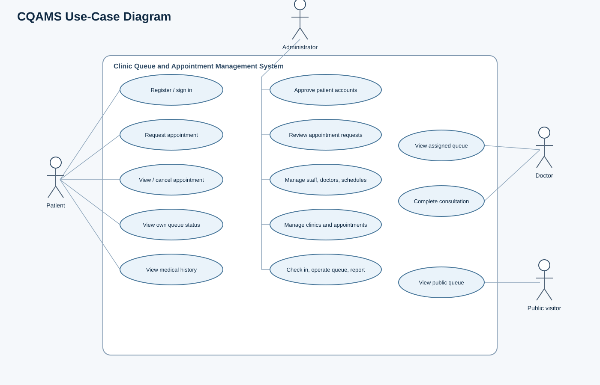
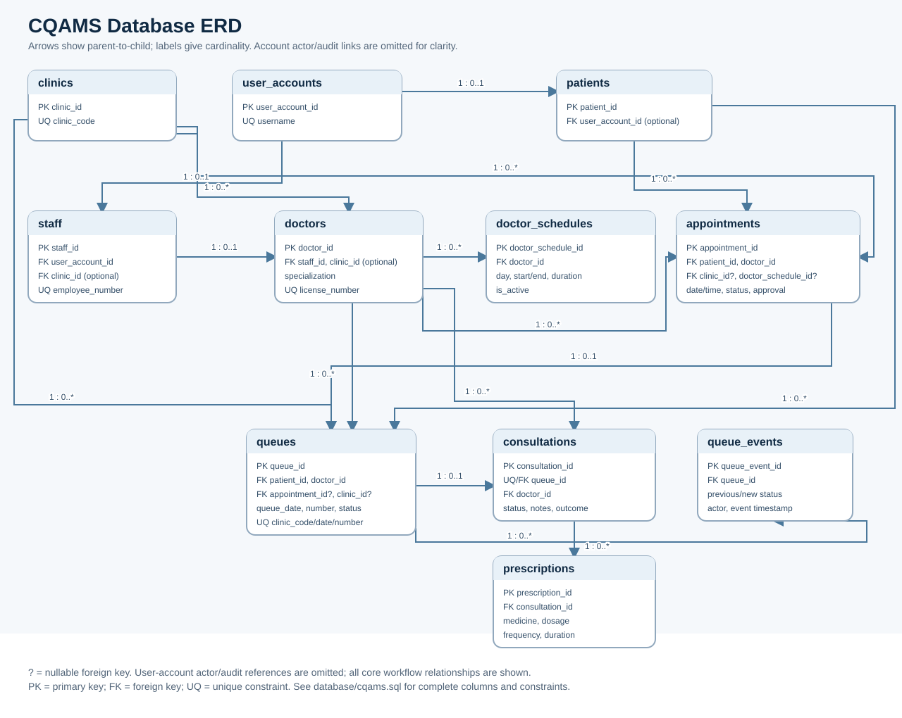
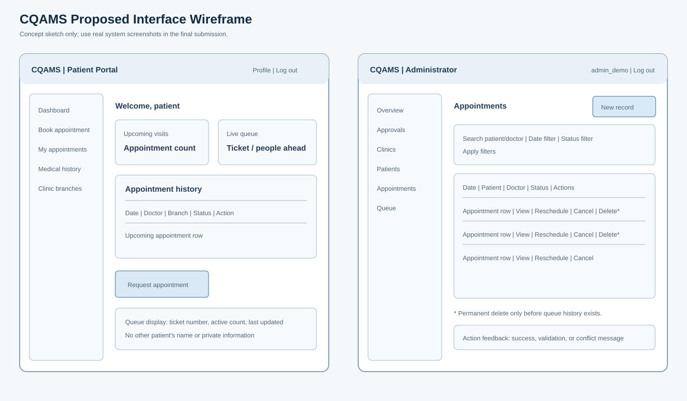

# Clinic Queue and Appointment Management System (CQAMS)
## Final Project Report

| Project information | Details |
|---|---|
| Programme | Diploma in Computer Science |
| School | School of Computing (SOC) |
| Project proposal | Submitted previously |
| Project team | Two members, as permitted for this project |
| Report date | 21 November 2026 |
| Lecturer | [Insert lecturer's name] |
| Institution | [Insert institution name] |

### Group members

| Member | Main responsibility |
|---|---|
| [Insert Student 1 full name] | Main development, database design, and system integration |
| [Insert Student 2 full name] | Testing, debugging, and report preparation |

> **Before submission:** Replace the bracketed personal-information placeholders and insert the actual application/phpMyAdmin screenshots in Section 10. The wireframe is conceptual and is not a substitute for application screenshots.

## Abstract

The Clinic Queue and Appointment Management System (CQAMS) is a database-driven web application for managing patient registrations, appointment requests, clinic schedules, check-in, daily queues, and doctor consultations. Patients can register, request appointments, review their appointment status, and view their own live queue position. Administrators manage approvals, clinics, staff, doctors, schedules, appointments, queues, and operational reports. Doctors view their assigned work and record consultation outcomes.

The application uses HTML5, CSS3, vanilla JavaScript, PHP 8+, PDO, and MySQL/MariaDB in the XAMPP environment. Its main workflow was tested locally using temporary records. The verified workflow includes patient registration and approval, appointment booking and approval, check-in, queue calling, consultation completion, and reporting. Temporary test records were removed after testing.

## Table of Contents

1. [Introduction](#1-introduction)
2. [Problem Statement](#2-problem-statement)
3. [Objectives](#3-objectives)
4. [Scope](#4-scope)
5. [Target Users](#5-target-users)
6. [System Requirements](#6-system-requirements)
7. [System Design and Architecture](#7-system-design-and-architecture)
8. [Use-Case Design](#8-use-case-design)
9. [Database Design](#9-database-design)
10. [Interface Design and Screenshots](#10-interface-design-and-screenshots)
11. [System Implementation](#11-system-implementation)
12. [CRUD Implementation](#12-crud-implementation)
13. [JavaScript Features](#13-javascript-features)
14. [Testing and Results](#14-testing-and-results)
15. [Validation, Security, and Privacy](#15-validation-security-and-privacy)
16. [Problems and Solutions](#16-problems-and-solutions)
17. [Limitations and Future Enhancements](#17-limitations-and-future-enhancements)
18. [Group Member Responsibilities](#18-group-member-responsibilities)
19. [Conclusion](#19-conclusion)
20. [References](#20-references)
21. [Appendix A: Local Setup and Demonstration](#appendix-a-local-setup-and-demonstration)

## 1. Introduction

CQAMS is a web-based clinic information system that supports the flow from patient registration and appointment requests to clinic check-in, queue progression, and doctor consultation. It provides separate workspaces for patients, administrators, and doctors, as well as a public queue display that presents queue information without exposing patient identities.

The project applies the required web development technologies in a traditional PHP application architecture. PHP processes requests and enforces business rules, PDO communicates with the database, and vanilla JavaScript uses the Fetch API for interactive pages.

## 2. Problem Statement

Clinics that coordinate appointments and waiting lines manually may encounter duplicate bookings, unclear waiting order, delays during check-in, and difficulty coordinating staff, doctors, and patients. Patients may not know whether an appointment request has been approved or how many active queue tickets are ahead of them. Staff may have to consult several records to understand a clinic's daily workload.

CQAMS addresses these problems by centralizing appointment requests, administrator decisions, schedules, check-in, queue progress, consultation status, and operational reporting in one database-driven application.

## 3. Objectives

The objectives of CQAMS are to:

1. Provide authenticated patient, administrator, and doctor workspaces.
2. Allow patients to register and request appointments from available clinic, doctor, date, and time options.
3. Allow administrators to review patient registrations and appointment requests.
4. Prevent conflicting active appointments and duplicate queue numbers for the same clinic and date.
5. Support appointment check-in, queue calling, and consultation completion.
6. Allow patients to view their own appointment and live queue status.
7. Provide clinic, staff, doctor, schedule, appointment, and patient management functions.
8. Display database-backed dashboard statistics and operational reports.
9. Keep the public queue display free of patient names and other private patient information.

## 4. Scope

### 4.1 Included features

- Patient self-registration and administrator approval.
- Login and logout for approved patients and staff.
- Role-based patient, administrator, and doctor workspaces.
- Patient search, registration, and profile viewing/editing by authorized staff.
- Clinic branch management.
- Staff accounts, doctor profiles, and doctor schedule management.
- Patient appointment requests, approval/rejection, viewing, rescheduling by an administrator, cancellation, and safe permanent deletion.
- Appointment check-in and walk-in check-in.
- Daily queue number generation and queue operations.
- Doctor consultation start and completion with notes and an outcome.
- Patient medical/consultation history and private queue status.
- Administrator dashboard, date-filtered reports, CSV export, and a public queue display.

### 4.2 Outside the project scope

Billing, payment processing, pharmacy management, insurance claims, a full electronic medical record system, AI diagnosis, notifications, and external messaging integrations are not included.

## 5. Target Users

| User | Main activities |
|---|---|
| Patient | Register, request or cancel eligible appointments, view appointment status, view personal consultation history, and track their own queue ticket |
| Administrator | Review patient and appointment requests; manage clinics, patients, staff, doctors, schedules, and appointments; check patients in; operate queues; and view reports |
| Doctor | View assigned appointments and queue records, start consultations, and record consultation outcomes |
| Public visitor | View privacy-safe queue numbers and doctor labels on the public display |

Patients do not use administrator or doctor workspaces. Public visitors can read the queue display but cannot operate the queue.

## 6. System Requirements

### 6.1 Development and runtime environment

- Windows computer
- XAMPP with Apache, PHP 8+, and MySQL/MariaDB
- phpMyAdmin for database setup and inspection
- Modern web browser

### 6.2 Application technologies

| Technology | Use in CQAMS |
|---|---|
| HTML5 | Page structure and forms |
| CSS3 | Shared page styling and responsive layouts |
| Vanilla JavaScript | Validation, filtering, dialogs, availability updates, and refresh behavior |
| Fetch API | Browser requests to PHP JSON endpoints |
| PHP 8+ | Authentication, authorization, validation, and business rules |
| PDO | Prepared database queries and transactions |
| MySQL/MariaDB with InnoDB | Persistent system records and relational constraints |
| XAMPP / Apache | Local development and demonstration environment |
| phpMyAdmin | Database import, inspection, and demonstration |

No frontend or PHP framework is required.

## 7. System Design and Architecture

CQAMS follows a traditional PHP application architecture:

1. A browser requests a PHP page or submits a form.
2. PHP checks the session and role, validates input, and applies the business rules.
3. PDO executes prepared SQL statements against MySQL/MariaDB.
4. PHP renders a page or returns a JSON response.
5. Vanilla JavaScript updates interactive tables and forms using the Fetch API.

The application keeps database queries in PHP rather than frontend JavaScript. Shared includes provide database access, authentication, permission checks, common layout, output escaping, validation, and consistent JSON responses.

The main workflow is:

**Patient registration -> administrator approval -> patient appointment request -> appointment approval -> check-in -> queue calling -> doctor consultation -> completion -> reporting**

## 8. Use-Case Design

The use-case diagram summarizes the responsibilities of the four actors:

- Patients manage their own registration, appointments, queue status, and history.
- Administrators review requests and manage clinic operations.
- Doctors view assigned queue work and complete consultations.
- Public visitors view the public queue without accessing patient records.

## 9. Database Design

The schema is defined in [database/cqams.sql](../database/cqams.sql), and development sample data is provided in [database/seed_demo_data.sql](../database/seed_demo_data.sql).

### 9.1 Main entities

| Table | Purpose |
|---|---|
| `clinics` | Clinic branch identity, contact details, and active state |
| `user_accounts` | Username, password hash, role, approval state, and account status |
| `staff` | Administrator and doctor staff details linked to an account |
| `patients` | Patient identity, registration number, and contact information |
| `doctors` | Doctor profile, specialization, license, and clinic association |
| `doctor_schedules` | Recurring doctor availability and slot duration |
| `appointments` | Patient/doctor booking, appointment status, and approval decision |
| `queues` | Clinic/date queue ticket and current queue status |
| `queue_events` | Queue status-transition history and the acting account |
| `consultations` | Consultation status, notes, outcome, and timestamps |
| `prescriptions` | Optional prescription details linked to a consultation; this is not a pharmacy module |

### 9.2 Main relationships and integrity rules

- A user account can be linked to a staff profile or a patient profile.
- A staff profile may be linked to one doctor profile.
- A doctor can have multiple schedules and appointments.
- A patient can have multiple appointments and queue records.
- An appointment may be linked to a queue record after check-in.
- A queue record can have queue events and a consultation record.
- A consultation can have optional prescription rows.

InnoDB foreign keys preserve related records. Unique constraints protect patient registration numbers, active appointment slots, and queue numbers for a clinic/date. Appointment deletion is restricted when queue history exists; clinic deletion is restricted when system records reference the branch.

## 10. Interface Design and Screenshots

The interface provides a public landing page and queue display, patient portal, administrator workspace, doctor workspace, data tables, and forms. Shared navigation and styling are used across authenticated areas. The wireframe below illustrates the proposed page structure; it is not evidence of the running system.

### 10.1 Actual application screenshots

Replace each placeholder with a real screenshot from the running CQAMS application. Add a short caption explaining what the screenshot demonstrates. Store image files under `docs/screenshots/` and update each placeholder with the corresponding image link.

#### Screenshot 1 - Landing page and navigation

**[SCREENSHOT PLACEHOLDER: Insert the actual CQAMS landing page and navigation.]**

#### Screenshot 2 - Patient registration and validation

**[SCREENSHOT PLACEHOLDER: Insert the registration form. Show its required fields or a meaningful validation message.]**

#### Screenshot 3 - Patient account approval

**[SCREENSHOT PLACEHOLDER: Insert the administrator patient-approval list with a valid test registration.]**

#### Screenshot 4 - Patient appointment request

**[SCREENSHOT PLACEHOLDER: Insert available doctor/time choices and a submitted pending appointment request.]**

#### Screenshot 5 - Appointment approval and filtering

**[SCREENSHOT PLACEHOLDER: Insert the administrator appointment approval page and/or appointment search/filter results.]**

#### Screenshot 6 - Clinic branch CRUD

**[SCREENSHOT PLACEHOLDER: Insert clinic branch create/read/update/delete evidence using a temporary unused branch.]**

#### Screenshot 7 - Patient queue and public queue display

**[SCREENSHOT PLACEHOLDER: Insert the patient's ticket/position and the public display showing queue numbers without patient names.]**

#### Screenshot 8 - Doctor consultation

**[SCREENSHOT PLACEHOLDER: Insert the doctor's assigned queue and a completed consultation record.]**

#### Screenshot 9 - Dashboard, report, and phpMyAdmin

**[SCREENSHOT PLACEHOLDER: Insert database-backed dashboard/report output and phpMyAdmin showing the CQAMS tables.]**

## 11. System Implementation

The project is organized into role-based PHP pages, PHP API endpoints, shared includes, JavaScript and CSS assets, and SQL setup files.

| Module | Main functions |
|---|---|
| Authentication | Login, logout, session handling, and account-state checks |
| Patient | Registration, appointment requests, appointment status, personal queue status, clinics, and consultation history |
| Administrator | Patient/appointment approvals, clinic and patient management, staff accounts, doctors, schedules, appointments, queue operations, dashboard, and reports |
| Doctor | Assigned appointments and queues, consultation start/completion, and consultation history |
| Public queue | Read-only queue numbers, doctor labels, waiting count, and update time |

PHP validates incoming data and enforces permissions on protected pages and endpoints. PDO prepared statements are used for database operations involving request values. Transactions are used for operations that must succeed or fail together, such as account creation and queue transitions.

## 12. CRUD Implementation

The two major entities demonstrated for the course CRUD requirement are clinic branches and appointments.

| Entity | Create | Read | Update | Delete |
|---|---|---|---|---|
| Clinic branches | Administrator creates a branch | Branches appear in the clinic list | Administrator edits branch information | Permanent deletion is allowed only when no staff, doctors, appointments, or queues reference the branch |
| Appointments | Patient requests a booking or administrator creates one | Patient and administrator lists and detail views | Administrator reschedules an eligible appointment | Permanent deletion is allowed only before queue history; otherwise the appointment must be cancelled to preserve service history |

Patient profiles are not freely deleted because they can be linked to appointments, queues, consultations, and medical history. Staff accounts can be activated or disabled; doctor profiles and schedules are managed separately.

## 13. JavaScript Features

The application uses native JavaScript and the Fetch API for the following interactive features:

1. **Client-side form validation:** Required fields, input formats, and registration password confirmation are checked in the browser, with server-side validation as the final check.
2. **Appointment availability:** Selecting a clinic, doctor, and date loads working slots and current availability.
3. **Search and filtering:** Appointment, patient, queue, and history tables provide relevant search or filter interactions.
4. **Confirmation dialogs:** Important appointment actions require confirmation.
5. **Live queue refresh:** The patient queue status and public display refresh periodically without a full page reload.
6. **Feedback messages:** Forms and API-backed actions display success or error messages.

## 14. Testing and Results

### 14.1 Test environment and approach

Functional tests were performed against the local CQAMS application running through XAMPP and its configured MySQL/MariaDB database. Tests covered page loading, role workflows, database reads and writes, common validation cases, CRUD operations, queue transitions, and reporting. Temporary test records were removed after testing.

### 14.2 Functional test results

| ID | Test | Result |
|---|---|---|
| T01 | Open the landing page and the public queue display | Passed; pages loaded without PHP fatal errors |
| T02 | Sign in as administrator, patient, and doctor | Passed for all three roles |
| T03 | Reject registration with mismatched passwords | Passed; a validation message was shown and no account was created |
| T04 | Register a patient, approve the account, and sign in | Passed using a temporary registration; the account appeared in the approval list and could sign in after approval |
| T05 | Load clinic, doctor, and schedule choices; display available appointment times | Passed; available slots were returned and shown for a scheduled doctor/date |
| T06 | Submit a patient appointment request and review it as an administrator | Passed; request remained pending until approval |
| T07 | Reschedule an eligible appointment | Passed; the update preserved clinic and visit category |
| T08 | Permanently delete an appointment without queue history | Passed; record was removed and the slot was released |
| T09 | Permanently delete an appointment with queue history | Passed; deletion was blocked with HTTP 409 and history was preserved |
| T10 | Create, view, update, and delete an unused clinic branch | Passed; temporary branch was removed |
| T11 | Delete a clinic branch referenced by system records | Passed; deletion was blocked with HTTP 409 |
| T12 | Create a staff account and activate/deactivate it | Passed using a temporary account; temporary record was removed |
| T13 | Create/update a doctor profile and schedule; toggle schedule state | Passed using temporary records; temporary records were removed |
| T14 | Create an overlapping active doctor schedule | Passed; overlap was rejected with HTTP 409 |
| T15 | Check in a walk-in patient and generate a daily queue number | Passed; the test patient received a new queue number |
| T16 | Call the queue ticket and display the patient's live queue status | Passed; ticket status, people ahead, and currently called numbers were shown |
| T17 | Start and complete the assigned doctor's consultation | Passed; consultation and queue reached `completed` |
| T18 | Show the completed consultation in the patient's history | Passed; the outcome appeared in the patient's history |
| T19 | Search/filter appointments and patient history | Passed; matching and no-match results were displayed |
| T20 | Generate a date-range report and export CSV | Passed; report rows were displayed and CSV response returned with a valid header |
| T21 | Submit a report range whose start date is after its end date | Passed; invalid range was rejected with HTTP 422 |
| T22 | Verify public queue data does not expose patient identity/contact fields | Passed; the public output contained queue numbers and doctor labels, not patient names or contact details |
| T23 | Run PHP syntax checks across the project | Passed; all 65 PHP files passed `php -l` |

### 14.3 Test data cleanup

Temporary test patient, appointment, queue, consultation, staff account, doctor profile, schedule, and related queue-event records were removed. The database returned to its pre-test record counts.

### 14.4 Existing sample-data note

The configured development database contains a legacy `pending_patient` account without a linked patient profile. Because the approval list displays patient profiles joined to their accounts, that orphan account does not appear in the pending list. The registration-to-approval workflow was verified with a complete temporary registration. For a live demonstration, use a newly registered patient or correct the sample data in a test database.

### 14.5 Verification boundaries

The tests above are functional tests in the local XAMPP environment. Formal penetration testing, performance benchmarking, and cross-device/browser certification were not performed.

## 15. Validation, Security, and Privacy

- Passwords are stored with PHP `password_hash()` and checked with `password_verify()`.
- Protected pages and APIs check authentication and role on the server.
- Request values are validated in PHP; prepared PDO statements are used for user-supplied values.
- HTML output is escaped to reduce cross-site scripting risk.
- CSRF tokens protect authenticated state-changing requests.
- Transactions and database constraints protect related updates and prevent conflicting records.
- Queue and appointment history is retained when permanent deletion could damage service records.
- The public queue display excludes patient names, identification numbers, phone numbers, addresses, and consultation notes.

These are implemented application measures; they do not represent a formal security audit.

## 16. Problems and Solutions

| Problem encountered | Solution |
|---|---|
| Existing database schemas did not include all tables/columns expected by the application | Added documented migrations and applied them to the configured database after preserving a backup |
| Patients needed approval before accessing the system | Added pending registration and administrator approval |
| Appointment requests needed a review step | Added pending/approved/rejected appointment states and administrator review |
| Patients could not see their place in the live queue | Added a patient-authenticated queue status endpoint and periodic refresh |
| Appointment rescheduling returned a server error | Matched update SQL parameters with validated booking data and preserved the appointment's clinic and visit category |
| Permanent deletion could damage queue history | Blocked permanent deletion when a queue record exists; cancellation remains available |
| Clinic deletion could remove branch associations from records | Blocked branch deletion when staff, doctors, appointments, or queues reference it |
| Overlapping doctor schedules could offer conflicting availability | Added server-side overlap checks for active schedules |
| A seeded pending demo account did not appear in approvals | Identified that the configured database has no patient profile linked to that account; a valid registration was used to verify the approval workflow |

## 17. Limitations and Future Enhancements

The following items are outside the verified implementation or current project scope:

- Patient-requested appointment rescheduling is not implemented; rescheduling is performed by an administrator.
- Reports export as CSV; PDF export is not implemented.
- Profile photo uploads and external notifications are not implemented.
- The public queue display currently uses the configured `MAIN` clinic code and fixed clinic label.
- CQAMS does not implement billing, pharmacy, insurance claims, or a full electronic medical record.
- Formal security, load/performance, and cross-device/browser testing remain future verification work.

Possible future enhancements include patient-requested rescheduling with administrator review, configurable public queue branches, PDF reports, and notifications.

## 18. Group Member Responsibilities

The project proposal was submitted previously. The completed project was developed by a two-member team, which is permitted for this project. Replace the name placeholders below with the members' actual names.

| Member | Contribution |
|---|---|
| [Insert Student 1 full name] | Main development, database design, and system integration |
| [Insert Student 2 full name] | Testing, debugging, and report preparation |

Both members should be prepared to explain the complete application workflow and their individual contributions during the presentation.

## 19. Conclusion

CQAMS provides a database-backed workflow for patient registration, appointment requests, administrator approvals, clinic queue operations, doctor consultations, and operational reporting. It demonstrates the integration of HTML, CSS, vanilla JavaScript, PHP, PDO, and MySQL/MariaDB through XAMPP. The tested core workflows include CRUD for clinic branches and appointments, search/filter interactions, validation, queue number generation, consultation completion, and a privacy-safe public display.

The functional tests passed in the local environment, and temporary test records were removed. Before final submission, the team must replace the personal-information placeholders and insert real screenshots from the running application and phpMyAdmin.

## 20. References

1. Apache Friends. “XAMPP.” https://www.apachefriends.org/
2. MDN Web Docs. “Fetch API.” https://developer.mozilla.org/en-US/docs/Web/API/Fetch_API
3. MySQL Reference Manual. “InnoDB and Foreign Keys.” https://dev.mysql.com/doc/refman/8.0/en/innodb-foreign-key-constraints.html
4. PHP Documentation. “PDO.” https://www.php.net/manual/en/book.pdo.php
5. PHP Documentation. “password_hash.” https://www.php.net/manual/en/function.password-hash.php

## 21. Final Submission Checklist

- [ ] Replace the student, lecturer, and institution placeholders.
- [ ] Insert real application and phpMyAdmin screenshots in Section 10.
- [ ] Include the project source code and SQL setup/sample-data files.
- [ ] Use the database import instructions in Appendix A and do not import the destructive fresh-install schema over data that must be preserved.
- [ ] Demonstrate two entities' CRUD, search/filtering, JavaScript behavior, validation, and database interaction.
- [ ] Ensure both members can explain the complete workflow and their contributions.

## Appendix A: Local Setup and Demonstration

### A.1 Fresh XAMPP setup

1. Place the project at `C:\xampp\htdocs\CQMS`.
2. Start Apache and MySQL/MariaDB from the XAMPP Control Panel.
3. For a **new or disposable test database only**, import `database/cqams.sql` using phpMyAdmin. This schema recreates the CQAMS tables and is destructive to existing CQAMS data.
4. If sample records are needed, run `database/seed_demo_data.sql`.
5. Open `http://localhost/CQMS/`.
6. Use the demo accounts listed in [CQAMS-HANDOVER-GUIDE.md](CQAMS-HANDOVER-GUIDE.md) for role-based demonstrations.

### A.2 Demonstration sequence

1. Show the public landing page and navigation.
2. Register a patient and show the pending-account message.
3. Sign in as an administrator and approve the patient account.
4. Sign in as the patient and request an available appointment slot.
5. Approve the appointment as the administrator and show the patient appointment status.
6. Check in the appointment and show its queue number.
7. Show the patient's live queue status and the public queue display.
8. Sign in as the assigned doctor, start the consultation, record an outcome, and complete it.
9. Return to the patient history and administrator reports to show the completed record and updated data.
10. Demonstrate clinic branch and appointment CRUD/search using temporary or unserved records. Do not permanently delete records with queue or consultation history.

### A.3 Existing database warning

Do not import `database/cqams.sql` into an existing database containing data that must be kept. Back up the database before applying any migration. The configured development database already has the required migrations applied; do not rerun one-time migrations against it.
