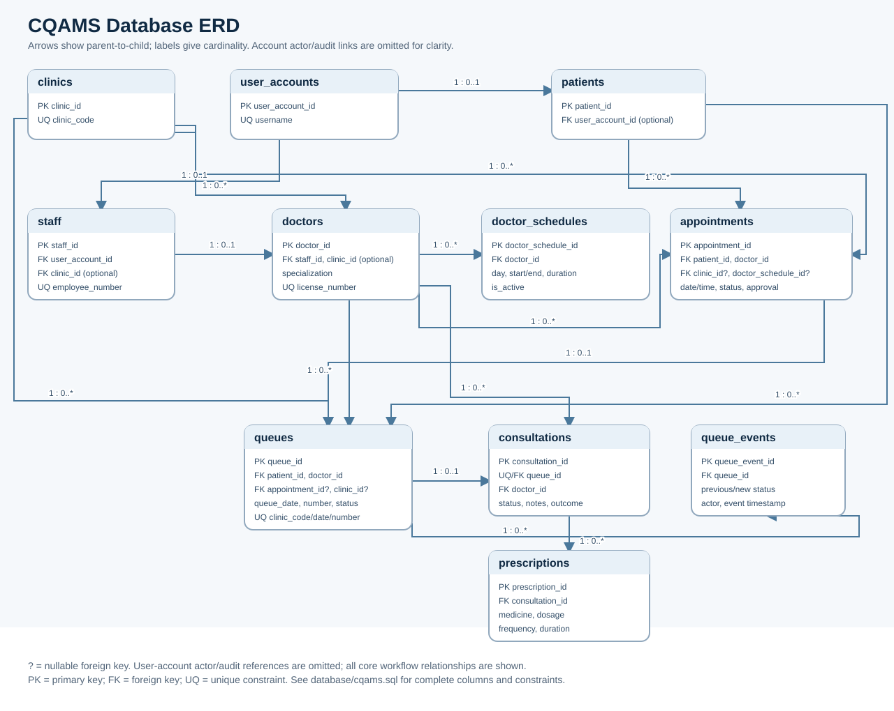
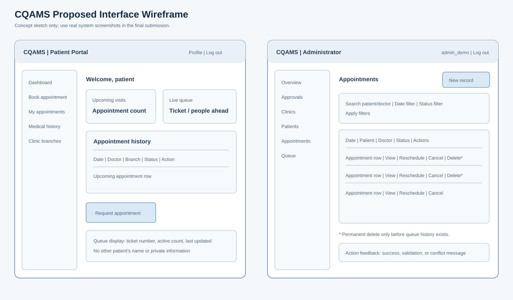

# CQAMS Project Proposal

## 1. System Title

**Clinic Queue and Appointment Management System (CQAMS)**

## 2. Group Information and Responsibilities

The provided course brief requires groups of 3–4 students. The current group has **2 members**, so the group-size requirement is not met unless the lecturer has approved an exception. Confirm this with the lecturer or add an approved third/fourth member before submission. Do not list a fictional member.

| Member | Responsibility |
|---|---|
| [Add your full name] | Main development, database design, and system integration |
| [Add the other member's full name] | Testing, debugging, and report writing |

Add names and update responsibilities to reflect the work each person actually completed. Both members should be able to explain the full system during assessment.

## 3. Problem Statement

Clinics that manage appointments and waiting lines manually may experience duplicate bookings, unclear queue status, slow patient handling, and limited visibility of daily operations. Patients may not know whether their appointment is approved or how many people are ahead in the queue. Staff may have difficulty coordinating schedules, approvals, and queue progress.

CQAMS is proposed as a database-driven system for managing patient registrations, doctor schedules, appointment requests, check-in, daily queue progression, and consultation completion.

## 4. Objectives

- Provide authenticated access for patients, doctors, and administrators.
- Let patients request appointments from available clinic, doctor, date, and time options.
- Allow administrators to review patient and appointment requests.
- Prevent duplicate active appointment slots and duplicate daily queue numbers.
- Provide check-in, queue calling, and doctor consultation workflows.
- Show patients their own queue status without exposing other patients' personal information.
- Provide database-driven dashboards and operational reports.

## 5. Target Users

- **Patients:** register, request and review appointments, cancel eligible visits, view personal history, and track their own queue ticket.
- **Administrators:** approve registrations and appointments, manage clinic branches, staff, doctors and schedules, check patients in, operate queues, and view reports.
- **Doctors:** view assigned work and complete consultations for assigned queue records.
- **Public visitors:** view privacy-safe queue numbers on a waiting-room display.

## 6. Proposed Features

- Secure login, logout, and server-side role authorization.
- Patient registration, search, validation, and duplicate prevention.
- Clinic branch, staff, doctor profile, and schedule management.
- Appointment create, read, reschedule, cancel, and safe permanent deletion before queue history.
- Patient and appointment approval workflows.
- Daily check-in and queue number generation.
- Queue calling, recall, skip, return, service start, completion, and cancellation.
- Doctor consultation start and completion.
- Patient-specific live queue status.
- Dashboard statistics, report filtering, CSV export, and a public queue display.

## 7. Functional Requirements

1. The application must authenticate approved users and enforce roles in PHP.
2. The system must store application records in MySQL using PDO.
3. Patients must be able to register and request available appointment slots.
4. Administrators must be able to approve or reject patient and appointment requests.
5. The system must prevent conflicting active doctor and patient appointment slots.
6. Administrators must be able to search, view, create, update, and safely delete clinic branches and appointment records.
7. The system must check patients in and issue a unique queue number for a clinic and date.
8. Doctors must be restricted to assigned consultation work.
9. The public queue must not expose patient names or other personal information.
10. The application must provide meaningful validation and success/error messages.

## 8. Proposed Technology and Environment

- HTML5, CSS3, and vanilla JavaScript
- PHP 8+ with PDO
- MySQL or compatible MariaDB using InnoDB
- Apache and MySQL/MariaDB through XAMPP
- phpMyAdmin for database setup and demonstration

No frontend or PHP framework is required.

## 9. Database Design

The database contains clinic, account, staff, patient, doctor, schedule, appointment, queue, consultation, and queue-event entities. Primary keys identify records; foreign keys and unique constraints maintain relationships and prevent duplicate appointments and queue numbers. The current schema and seed records are in [database/cqams.sql](../database/cqams.sql) and [database/seed_demo_data.sql](../database/seed_demo_data.sql).

## 10. Proposed Interface

The interface uses shared navigation and responsive HTML/CSS pages. Patients see appointment and personal queue information; administrators see approval, CRUD, queue, and reporting tools; doctors see assigned consultation work.

This is a conceptual wireframe, not a screenshot. Insert screenshots of the actual running application in the final report.

## 11. Scope

The proposed scope includes registration and approvals, doctor schedules, appointment requests, queue operations, consultation completion, reports, and a privacy-safe public display. Billing, pharmacy, insurance claims, and AI diagnosis are outside the project scope.

## 12. Current Status and Items to Confirm

- The working system and SQL setup files are present in the project.
- The appointment approval and CRUD flows have been exercised in the local XAMPP environment.
- Add real member names and actual individual contributions.
- Resolve the 2-member group-size conflict with the lecturer.
- Add actual interface and phpMyAdmin screenshots before submission.
- Confirm that the lecturer accepts the system's history-preserving deletion rules.
